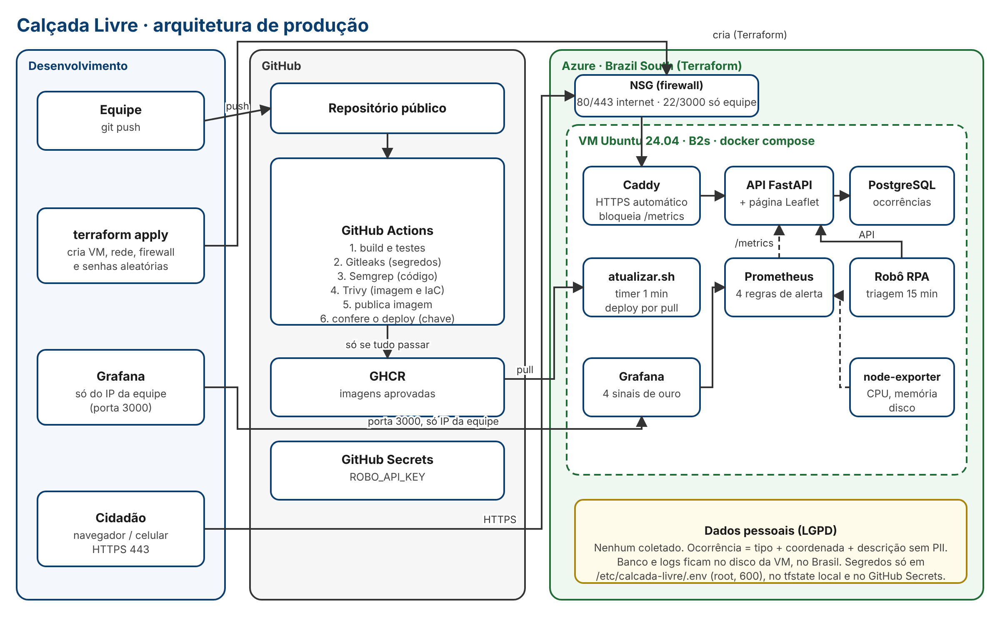

# Calçada Livre

Mapa colaborativo de barreiras de acessibilidade em calçadas de São Paulo. Este repositório contém o **MVP** (API + página web) e toda a **produção DevSecOps**: container, infraestrutura como código, pipeline com barreiras de segurança e observabilidade.

FIAP Global Solution 2026.2 · Engenharia de Software 4º ano · disciplina *Secure DevOps Tools & Cloud Computing* (prof. Gabriel Arcanjo e Cleórbete Santos).

## Integrantes

| Nome completo | RM |
|---|---|
| Carlos Ganzerli | 99840 |
| Paulo Lopes | 551137 |
| Lucas Bandeira | 98640 |
| Gustavo Melo | 98809 |

## Ficha Técnica do MVP

| Item | Conteúdo |
|---|---|
| Nome | Calçada Livre |
| Cidadão e território | Pessoas com deficiência, idosos e pais com carrinho de bebê, no município de São Paulo (SP) |
| Problema em uma frase | Barreiras em calçadas (buracos, degraus, obstáculos, falta de rampa, trechos escuros) impedem a circulação e não chegam organizadas a quem pode corrigi-las |
| Proposta de valor | Reunir relatos de cidadãos, de um robô inspetor e de uma câmera com IA num mapa único, triar automaticamente e encaminhar à subprefeitura certa com prioridade |
| Componentes | Página web com mapa e API (este repo) · robô de triagem RPA ([calcada-livre-rpa](https://github.com/CarlosGanzerli/calcada-livre-rpa)) · carrinho inspetor (Maker Lab) · visão computacional · pipeline de dados · assistente com LLM local |
| Fontes de dados | Relatos do app, leituras do carrinho, detecções da câmera, previsão Open-Meteo, pontos de interesse públicos |
| Modelos de IA | YOLO (detecção de barreiras), classificador embarcado no carrinho, LLM local (assistente) |
| URL e repositório | MVP: `<URL pública: preencher após o terraform apply>` · Repositório: https://github.com/CarlosGanzerli/calcada-livre |
| Indicadores de impacto | Tempo entre relato e encaminhamento · % de relatos triados sem intervenção humana · barreiras de prioridade alta perto de hospitais, escolas e pontos de ônibus |
| ODS | 11 (cidades e comunidades sustentáveis) · 10 (redução das desigualdades) · 3 (saúde e bem-estar) |

## Arquitetura



- **Uma VM Ubuntu na Azure (Brazil South)**, criada inteira por Terraform, roda tudo com `docker compose`: Caddy (HTTPS automático), API FastAPI, PostgreSQL, robô de triagem, Prometheus, Grafana e node-exporter.
- **Firewall (NSG):** só 80/443 abertos para a internet. SSH (22) e Grafana (3000) só aceitam o IP da equipe; o Terraform **recusa** `0.0.0.0/0` para essas portas.
- **Pipeline:** a cada push, build, testes, Gitleaks, Semgrep e Trivy. A imagem só é publicada no GHCR se tudo passar.
- **Deploy por pull:** a VM verifica a cada minuto se há versão nova aprovada e se atualiza sozinha. O pipeline então confere em produção que a versão nova está no ar. Assim o SSH nunca precisa ficar aberto para os IPs (variáveis) dos runners do GitHub.

Detalhes: [docs/devsecops.md](docs/devsecops.md).

## Rodar localmente

Requisito: Docker com Compose.

```bash
cp .env.example .env          # troque as senhas
docker compose up -d --build  # API, banco, Caddy, Prometheus e Grafana
```

- MVP: http://localhost
- Documentação da API: http://localhost/docs
- Grafana: http://localhost:3000 (usuário `admin`, senha do `.env`)

Sem Docker: `cd mvp && pip install -r requirements-dev.txt && pytest && ROBO_API_KEY=teste uvicorn app.main:app`.

## Colocar em produção

Passo a passo para quem nunca usou Azure: [docs/guia-deploy.md](docs/guia-deploy.md). Resumo:

```bash
cd infra/terraform
cp terraform.tfvars.example terraform.tfvars   # assinatura, seu IP e sua chave SSH
terraform init && terraform apply
terraform output url_publica
```

## Estrutura

```
mvp/                     API FastAPI, página acessível com mapa, testes e Dockerfile
docker-compose.yml       stack completa (perfis: monitoramento, robo)
infra/terraform/         VM, rede, firewall, IP público e cloud-init
infra/caddy/             proxy HTTPS e cabeçalhos de segurança
infra/monitoring/        Prometheus (regras de alerta) e Grafana (painel provisionado)
infra/deploy/            rotina de deploy por pull executada na VM
.github/workflows/       pipeline DevSecOps
docs/                    arquitetura, DevSecOps, custos, LGPD, guia de deploy e evidências
```

## Segurança e LGPD (resumo)

- Nenhum dado pessoal é coletado. A ocorrência tem tipo, coordenada e descrição; o robô remove telefone, e-mail e CPF escritos por engano.
- Dados ficam no Brasil (região Brazil South), no disco da VM.
- Segredos: gerados aleatoriamente pelo Terraform, gravados só em `/etc/calcada-livre/.env` na VM (root, 600) e no `terraform.tfstate` local; a chave do robô também no GitHub Secrets. Nada disso vai para o Git (`.gitignore`), e o Gitleaks barra o push se algo escapar.
- Container sem root, sistema de arquivos somente leitura, sem capabilities; `/metrics` bloqueado na internet.

Mais em [docs/devsecops.md](docs/devsecops.md).
