# DevSecOps da Calçada Livre

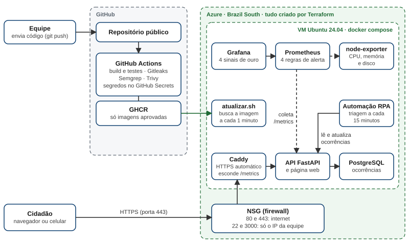

Como o MVP chega ao cidadão: empacotado em container, numa nuvem descrita por código, por um pipeline que barra segredo vazado e vulnerabilidade, e com monitoramento que avisa quando algo cai.

**No ar desde 18/11/2026:** <https://calcada-livre-vsqie.northcentralus.cloudapp.azure.com>

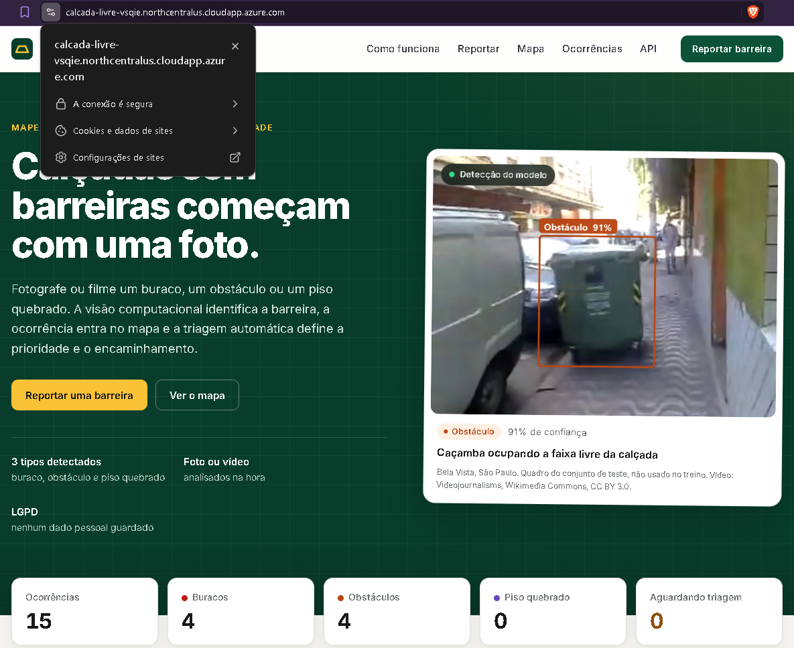

A mesma página, mais abaixo, com as ocorrências já triadas pela automação (protocolo, prioridade e subprefeitura). Os dados são simulados.

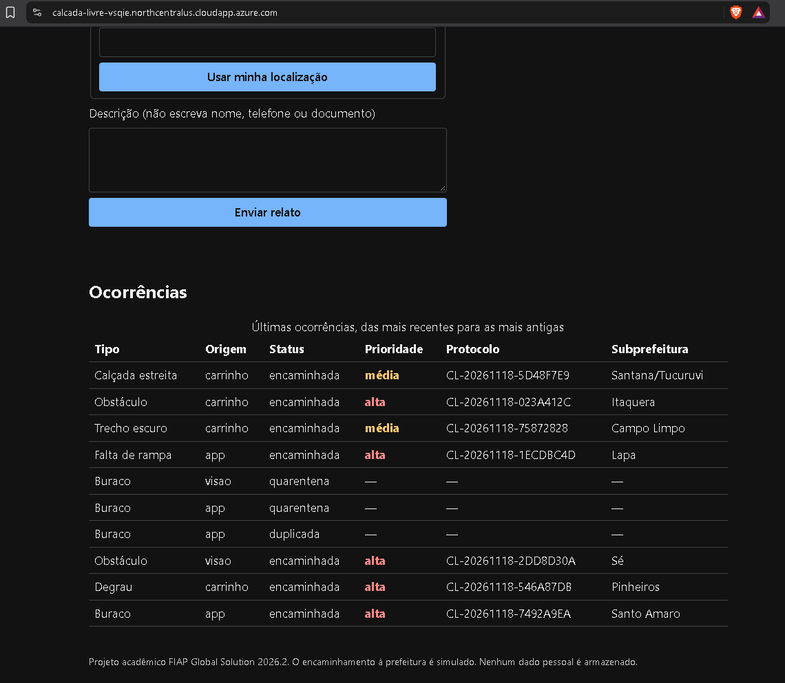

## 1. Container (2,0)

| Requisito | Como foi atendido | Onde |
|---|---|---|
| Dockerfile enxuto | Multi-stage: o estágio `build` instala as dependências num venv; a imagem final copia só o venv e o código, sem compiladores nem cache, e o pip da imagem base é removido. Tamanho: 70 MB compactada. Base `python:3.13-slim` com `apt-get upgrade` para receber as correções de segurança | `mvp/Dockerfile` |
| Usuário não root | `USER app` (uid 10001) | `mvp/Dockerfile` |
| Sem segredo na imagem | Nenhum `ENV` com senha; tudo chega por variável de ambiente em tempo de execução. `.dockerignore` exclui `.env` e bancos locais. O Trivy também procura segredos | `mvp/.dockerignore` |
| Stack com `docker compose` | `docker compose up -d` sobe banco, API, Caddy e, com perfis, a automação de triagem (serviço `robo`), Prometheus, Grafana e node-exporter | `docker-compose.yml` |
| Endurecimento extra | API com `read_only`, `cap_drop: ALL`, `no-new-privileges`; banco e Prometheus sem porta publicada; healthchecks; rotação de logs | `docker-compose.yml` |

**Produção, 18/11/2026:** os sete containers rodando na VM da Azure (`docker compose ps`, pelo Cloud Shell, sem SSH).

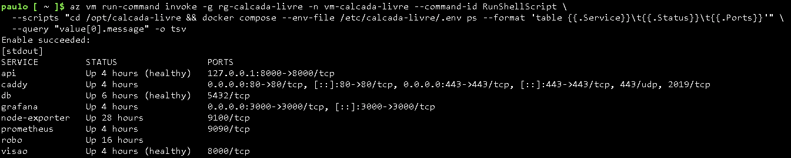

## 2. Infraestrutura como código (3,0)

Terraform com o provedor `azurerm` cria grupo de recursos, rede virtual, sub-rede, NSG (firewall), IP público com nome DNS, interface de rede e a VM Ubuntu 24.04 (B2as_v2: 2 vCPU e 8 GB). O `cloud-init` instala Docker, clona este repositório, grava o `.env` com senhas aleatórias e liga o timer de deploy. Nada é criado clicando no portal.

| Requisito | Como foi atendido |
|---|---|
| State fora do repositório | Backend local; `*.tfstate` e `.terraform/` no `.gitignore` |
| `.tfvars` fora do repositório | `*.tfvars` no `.gitignore`; só `terraform.tfvars.example` é versionado |
| Porta de administração nunca aberta para 0.0.0.0/0 | SSH (22) e Grafana (3000) aceitam só `var.admin_cidr`. A variável tem **validação**: o `terraform apply` falha se alguém tentar `0.0.0.0/0` ou uma faixa maior que /24. Uma regra final nega todo o resto. Isso é **testado a cada push** (`infra/terraform/tests/firewall.tftest.hcl`, com a Azure simulada) |
| Sem senha na VM | `disable_password_authentication = true`; acesso só por chave SSH |
| Segredos | `random_password` gera as senhas do Postgres, do Grafana e a chave de acesso da automação de triagem (`ROBO_API_KEY`). Ninguém digita, ninguém vê no chat ou no código |

O Trivy aponta como CRITICAL a regra que libera 80/443 para a internet (AVD-AZU-0047). É intencional, porque é o site público, e está justificado no `.trivyignore`; as portas administrativas continuam protegidas pela validação.

**Produção, 18/11/2026:** saída do `terraform apply` no Azure Cloud Shell, com os 13 recursos criados e a URL pública.

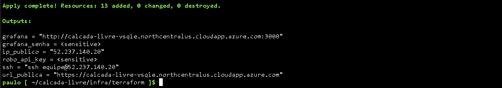

As regras do firewall (NSG) como ficaram no portal da Azure: 80 e 443 para a internet; 22 e 3000 só para o IP da equipe; todo o resto negado. O final do IP e o ID da assinatura foram cobertos nesta imagem porque o repositório é público.

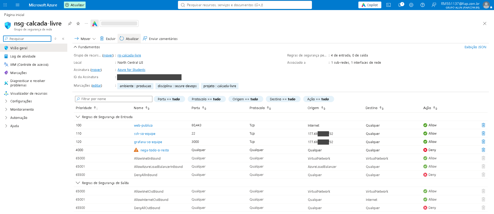

## 3. Pipeline DevSecOps (4,0)

Arquivo: `.github/workflows/devsecops.yml`. Roda a cada push e pull request. As cinco verificações rodam em paralelo, e a imagem só é publicada se todas passarem.

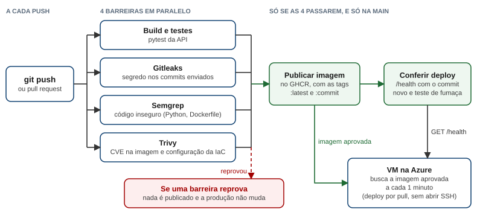

- **Gitleaks** analisa os commits que chegaram no push (no primeiro push, o histórico inteiro). Qualquer segredo reprova.
- **Semgrep** com as regras `p/python`, `p/dockerfile` e `p/secrets`; qualquer achado reprova (`--error`).
- **Trivy** reprova CVE CRITICAL ou HIGH que já tenha correção, e configuração insegura em Dockerfile, compose e Terraform.
- **Terraform** confere a formatação, valida a configuração (`terraform validate`) e roda os testes da infraestrutura (`terraform test`): `admin_cidr = 0.0.0.0/0` tem de ser recusado, e SSH e Grafana só podem aceitar o IP da equipe.
- **Segredos no GitHub Secrets:** `ROBO_API_KEY` (usada no teste de fumaça para provar que a autenticação funciona em produção sem alterar dados). A publicação no GHCR usa o `GITHUB_TOKEN` temporário do próprio Actions. A URL fica em *Variables* (`MVP_URL`), porque não é segredo.
- **Deploy automático:** a VM roda `infra/deploy/atualizar.sh` a cada minuto (timer do systemd). Ele baixa a imagem mais recente publicada, lê nela o commit que o pipeline aprovou (`GIT_SHA`) e deixa as configurações (compose, Caddyfile, Prometheus) nesse mesmo commit. Um commit barrado não chega à VM, nem como imagem nem como configuração. Se a configuração do proxy ou do monitoramento mudou, Caddy, Prometheus e Grafana são reiniciados para carregá-la. O job final só fica verde quando `GET /health` em produção responde com o commit que acabou de passar no pipeline.

**Deploy automático em produção, 18/11/2026.** Na [execução nº 9](https://github.com/CarlosGanzerli/calcada-livre/actions/runs/44337279436), a imagem do commit `1abe301` foi publicada às 12h36min16s (horário de Brasília) e a VM passou a responder com esse commit 1 minuto e 55 segundos depois, sem ninguém entrar na máquina. Trecho do log do job **Conferir deploy em produção**:

```text
tentativa 10: produção em '70e4b73742a3d8890ae84a9427cd7ffdc271dc74'
tentativa 11: produção em '1abe3014457f3c9e4eac97a828e66245c92ead3e'
Deploy confirmado.
Fumaça OK
```

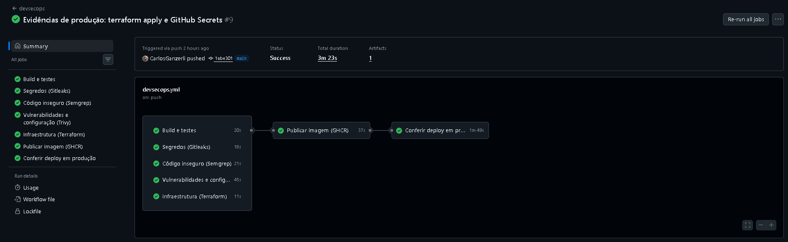

A chave `ROBO_API_KEY` cadastrada no GitHub Secrets (o valor não aparece para ninguém, nem para quem cadastrou):

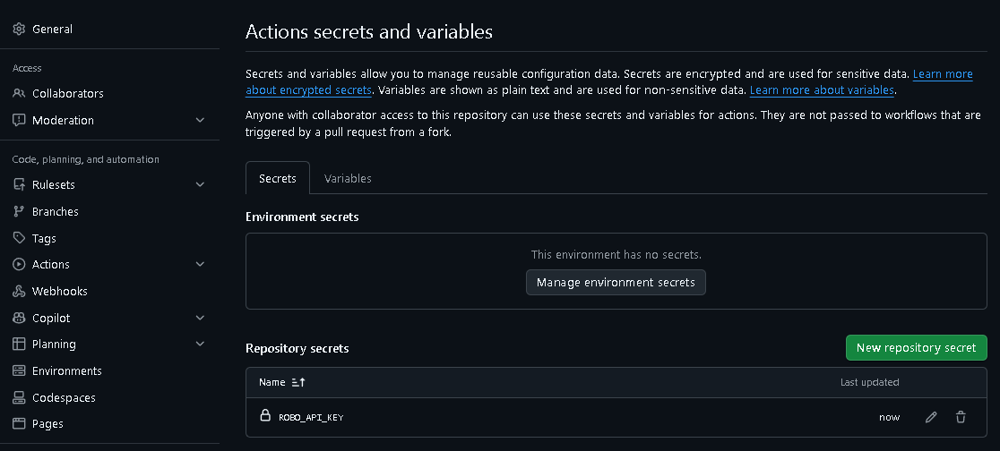

### Execução barrada e execução corrigida

Em 16/11/2026 foi feito, de propósito, um commit com uma chave de acesso colada num script. A chave é falsa e não dá acesso a nada. O pipeline barrou; o commit seguinte corrigiu.

| | Execução barrada | Execução corrigida |
|---|---|---|
| Commit | [`8ad629c`](https://github.com/CarlosGanzerli/calcada-livre/commit/8ad629cd45781744a90dd1d59607ed613989c917): chave colada em `infra/deploy/teste-fumaca.sh` | [`0b7eda4`](https://github.com/CarlosGanzerli/calcada-livre/commit/0b7eda4): a chave sai do arquivo e passa a vir do ambiente |
| Execução | [nº 2](https://github.com/CarlosGanzerli/calcada-livre/actions/runs/43983780826) | [nº 3](https://github.com/CarlosGanzerli/calcada-livre/actions/runs/43983901312) |
| Build e testes | passou | passou |
| Gitleaks | **reprovou** | passou |
| Semgrep | passou | passou |
| Trivy | passou | passou |
| Publicar imagem | **não executou** | publicou |
| Conferir deploy | não executou | executou |

Trecho do log do Gitleaks na execução barrada (o valor da chave é ocultado pelo próprio Gitleaks):

```
Finding:     ROBO_API_KEY="REDACTED"
RuleID:      generic-api-key
Entropy:     4.684184
File:        infra/deploy/teste-fumaca.sh
Line:        12
Commit:      8ad629cd45781744a90dd1d59607ed613989c917
WRN leaks found: 1
##[error]Process completed with exit code 1.
```

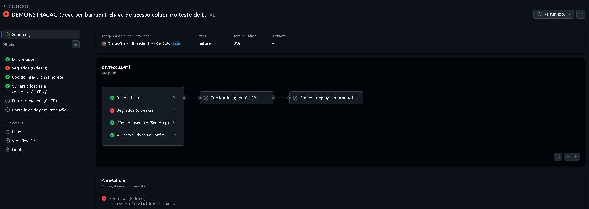

- Como a publicação depende de todas as verificações, a imagem do commit barrado nunca existiu no GHCR, e a VM continuou no commit anterior.
- O Semgrep não acusou essa chave (ela não tem um formato conhecido); o Gitleaks acusou pela entropia. Por isso as barreiras se somam.
- A chave falsa continua no histórico do Git, como evidência, e está registrada no `.gitleaksignore`. Com um segredo de verdade, apagar o arquivo não basta: o primeiro passo é **revogar** a chave.
- O job **Conferir deploy** só confere a produção depois que a variável `MVP_URL` é cadastrada (passo 6 do [guia de deploy](guia-deploy.md)); antes disso ele registra um aviso e não falha.

**Por que deploy por pull e não por SSH?** Para fazer SSH a partir do GitHub Actions seria preciso liberar a porta 22 para os IPs dos runners, que mudam o tempo todo, na prática abrindo a porta de administração para a internet. Com o pull, nenhuma porta administrativa fica exposta e a VM só executa imagens que passaram por todas as barreiras.

## 4. Observabilidade (3,0)

Prometheus coleta as métricas da API (`/metrics`, só na rede interna) e da VM (node-exporter). O Grafana já sobe com a fonte de dados e o painel **"Calçada Livre · 4 sinais de ouro"** provisionados por arquivo.

| Sinal de ouro | Métrica | Painel |
|---|---|---|
| Latência | `http_request_duration_highr_seconds` (p50, p95, p99) | Latência |
| Tráfego | `rate(http_requests_total)` por rota | Tráfego por rota, Requisições por segundo |
| Erros | proporção de respostas 5xx, e 4xx/5xx por código | Erros (5xx), Erros por código |
| Saturação | CPU, memória e disco da VM; requisições em andamento | Saturação da VM, Requisições em andamento |

Regras de alerta (`infra/monitoring/prometheus/alertas.yml`): **ApiForaDoAr** (API sem responder por 1 min), **TaxaDeErrosAlta** (> 5% de 5xx por 2 min), **LatenciaAlta** (p95 > 1 s por 5 min) e **VmSaturada** (CPU > 85% ou memória > 90% por 5 min). O painel mostra os alertas disparados.

**Como disparar o alerta:** o passo 9 do [guia de deploy](guia-deploy.md) para a API na VM (pausando a rotina de deploy, que a religaria em menos de 1 minuto). Em cerca de 1 minuto e meio o ApiForaDoAr passa a *firing* e o painel fica vermelho.

**Produção, 18/11/2026.** O painel aberto pelo IP público da VM, com o tráfego real do MVP, do healthcheck e da conferência do pipeline:

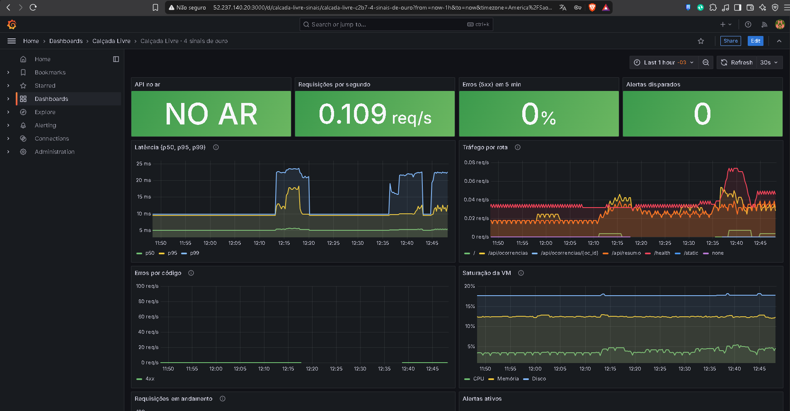

**Alerta disparado em produção.** Às 13h04 a API foi parada de propósito na VM, com a rotina de deploy pausada. O Prometheus deixou de conseguir ler a API e, 1 minuto depois, o alerta `ApiForaDoAr` passou a *firing*. A API foi religada às 13h19. As duas imagens abaixo são o mesmo painel com o intervalo de tempo terminando às 13h12, no meio da parada: foram tiradas depois, pelo histórico do Grafana, e o seletor de tempo no topo mostra o intervalo.

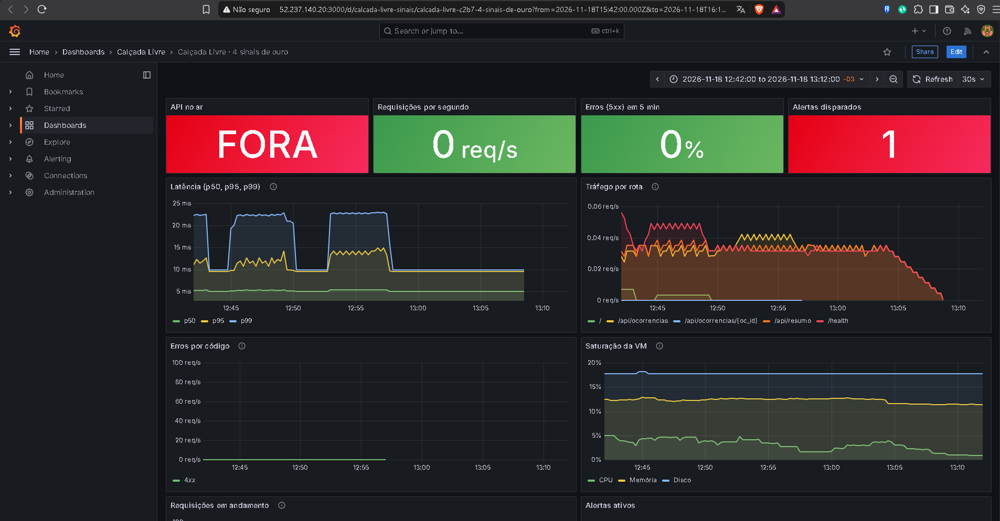

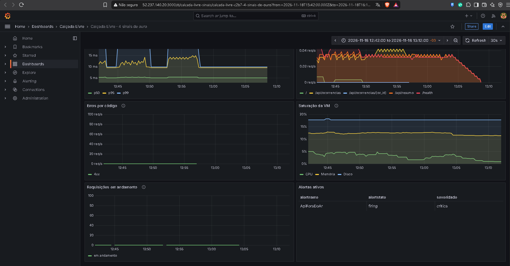

O enunciado também permite rodar Prometheus e Grafana no computador apontando para o MVP publicado; aqui eles rodam na própria VM porque o `/metrics` é bloqueado na internet de propósito.

**Limitação conhecida:** o Grafana responde em HTTP na porta 3000 e é aberto pelo número do IP da VM, porque o nome do site só aceita HTTPS (cabeçalho HSTS). Isso é aceitável neste trabalho porque o firewall só deixa o IP da equipe chegar a essa porta. Num ambiente real ele ficaria atrás do Caddy, com HTTPS, como a API.

## 5. Documentação (2,0)

### Modelo de responsabilidade compartilhada (IaaS)

| Camada | Responsável |
|---|---|
| Data center, energia, rede física, hardware, hipervisor | Microsoft Azure |
| Disponibilidade da região e do IP público | Microsoft Azure |
| Sistema operacional da VM (atualizações, `unattended-upgrades`) | **Equipe** |
| Firewall (regras do NSG), chaves SSH | **Equipe** |
| Docker, imagens, dependências e suas vulnerabilidades | **Equipe** (barradas pelo Trivy) |
| Código da aplicação, autenticação, segredos | **Equipe** (Semgrep, Gitleaks, GitHub Secrets) |
| Dados e conformidade com a LGPD | **Equipe** |
| Monitoramento e resposta a incidentes | **Equipe** (Prometheus, Grafana, alertas) |

Como usamos IaaS (uma VM), a maior parte da responsabilidade é nossa. Num PaaS (App Service, Container Apps) o sistema operacional passaria para a Azure.

### Onde ficam os dados pessoais (LGPD)

| Dado | Pessoal? | Onde fica | Proteção |
|---|---|---|---|
| Ocorrência (tipo, coordenada, data, origem) | Não | PostgreSQL no disco da VM, região North Central US (Illinois, EUA) | Banco sem porta exposta; só a API acessa |
| Descrição livre | Pode conter por engano | Mesmo banco | A automação de triagem remove telefone, e-mail e CPF antes do encaminhamento; a página orienta a não escrever dados pessoais |
| IP de quem acessa | Sim (dado pessoal indireto) | Não é gravado: o log de acesso do Caddy fica desligado (padrão) e a API roda sem log de acesso (`--no-access-log`); só erros vão para o log do container, com rotação de 10 MB × 3 | Não é usado nem enviado a terceiros |
| Logs da automação de triagem | Não | Volume do serviço `robo` na VM | Recusam descrição, foto e coordenada |
| Métricas | Não | Prometheus (15 dias) | Só contagens e tempos |
| Segredos | Não pessoais, mas sensíveis | `/etc/calcada-livre/.env` (root, 600), `terraform.tfstate` local, GitHub Secrets | Fora do Git, Gitleaks no pipeline |

**Por que North Central US, e não Brazil South.** A assinatura Azure for Students usada no trabalho permite criar recursos em Brazil South, mas não oferece lá nenhum dos tamanhos de VM do projeto. O `preparar.sh` confere isso antes de criar a nuvem e escolheu a primeira região permitida com máquina disponível. Consequências para a LGPD:

- O MVP não coleta dados pessoais, então não há cadastro de cidadão guardado fora do Brasil.
- O único risco é alguém escrever um dado pessoal na descrição livre por engano. Nesse caso ele ficaria guardado nos EUA, o que seria uma transferência internacional (LGPD, arts. 33 a 36). Por isso a página orienta a não escrever dados pessoais e a automação de triagem remove telefone, e-mail e CPF.
- Num ambiente real, com assinatura paga, basta `regiao = "brazilsouth"` no `terraform.tfvars` para tudo ficar no Brasil. Nenhuma outra linha muda.

O mapa de fundo é baixado pelo navegador do cidadão direto do OpenStreetMap.

**Dados de demonstração.** As ocorrências que aparecem no MVP publicado são simuladas: vêm do cenário de demonstração da automação de triagem (`python -m triagem.semear`, no repositório [calcada-livre-rpa](https://github.com/CarlosGanzerli/calcada-livre-rpa)), que cria um caso para cada decisão da triagem. Nenhuma delas se refere a uma pessoa ou a um relato real.

### Estimativa de custo

Preços de tabela da Azure (pagamento por uso) para a região North Central US, em dólar, consultados em 18/11/2026 na [API pública de preços](https://prices.azure.com/api/retail/prices?currencyCode=USD&$filter=armRegionName%20eq%20'northcentralus'%20and%20armSkuName%20eq%20'Standard_B2as_v2'), a mesma fonte da [calculadora de preços](https://azure.microsoft.com/pt-br/pricing/calculator/). Mês de 730 horas.

| Recurso | Configuração | Preço unitário | US$/mês |
|---|---|---|---|
| Máquina virtual | B2as_v2 Linux (2 vCPU, 8 GB), ligada 24 h | US$ 0,0752 por hora | 54,90 |
| Disco do sistema | Standard SSD de 30 GB (faixa E4) | US$ 2,40 por mês | 2,40 |
| IP público | Standard, IPv4 estático | US$ 0,005 por hora | 3,65 |
| Tráfego de saída | primeiros 100 GB/mês gratuitos | | 0 |
| **Total** | | | **60,95** |

- **No período de avaliação:** nove dias no ar (18 a 26/11) custam cerca de US$ 18, cobertos pelos US$ 100 de crédito do Azure for Students.
- **Comparação com Brazil South:** a B2s (2 vCPU, 4 GB) custaria US$ 57,19 por mês com disco e IP, e os dados ficariam no Brasil. Não foi usada porque a assinatura de estudante não oferece esse tamanho nessa região.
- **Para gastar menos:** na mesma região, a B2als_v2 (2 vCPU, 4 GB) custa US$ 0,0376 por hora, e o total cai para US$ 33,50 por mês. Ficamos com 8 GB para ter folga com Postgres, Grafana e Prometheus na mesma máquina durante a correção.
- **Depois da correção:** `terraform destroy` apaga tudo e o custo zera.
